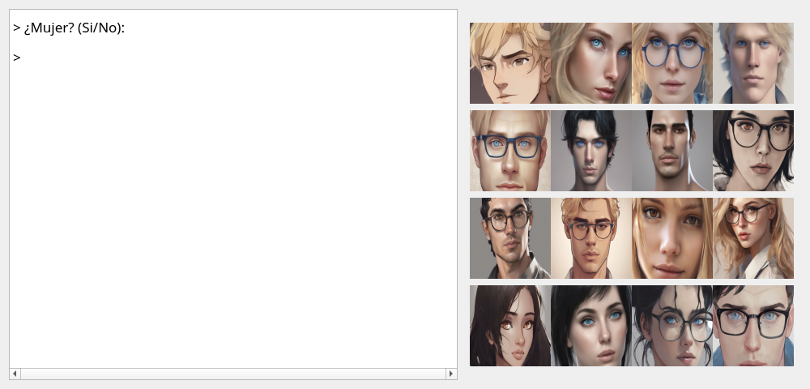
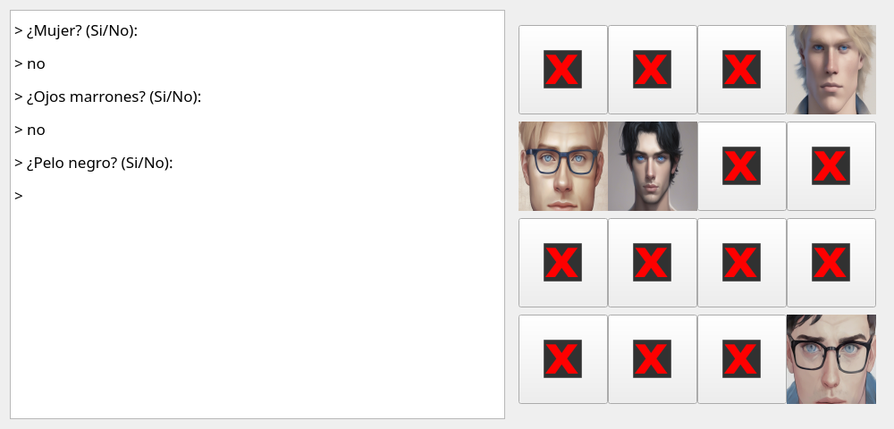
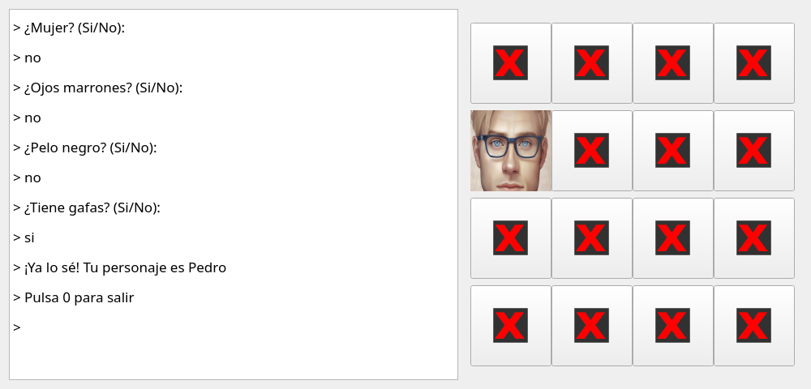

# ¿Quién es quién? en C++

[English](README.md) · **Español**

Un programa que juega a *¿Quién es quién?*. Lee una tabla de personajes con sus
atributos, construye un árbol binario de decisión con preguntas de sí/no y lo usa para
adivinar el personaje que ha elegido el usuario. Funciona en la terminal o con una ventana
de Qt que muestra el tablero.

Práctica final de la asignatura **Estructuras de Datos** (Doble Grado en Ingeniería
Informática y Matemáticas, Universidad de Granada, 2024).

| Inicio | Durante la partida | Final |
|:-:|:-:|:-:|
|  |  |  |

El programa hace las preguntas a la izquierda y tacha los personajes que ya no encajan.
En esta partida adivina a Pedro con cuatro preguntas.

## Qué he implementado

La asignatura proporcionaba la clase `bintree<T>`, la interfaz Qt y el código base. Mi
trabajo está en [`src/quienesquien.cpp`](src/quienesquien.cpp):

- **Construcción del árbol** (`crear_arbol`): en cada nodo elige el atributo con mayor
  entropía entre los personajes que quedan, es decir, la pregunta que los reparte de forma
  más equilibrada. Cada nodo guarda la pregunta y cada hoja un personaje.
- **Partida** (`iniciar_juego`): baja por el árbol según las respuestas. En modo gráfico
  tacha los personajes descartados.
- **Eliminación de nodos redundantes** (`eliminar_nodos_redundantes`): elimina las
  preguntas que solo tienen un hijo.
- **Profundidad media de las hojas** (`profundidad_promedio_hojas`): el número medio de
  preguntas necesarias para adivinar un personaje.
- **Añadir y eliminar personajes** (`aniade_personaje`, `elimina_personaje`): modifican un
  árbol ya construido sin rehacerlo. Están implementadas, pero el programa de línea de
  órdenes no las usa.
- **Información de la partida** (`informacion_jugada`, `preguntas_formuladas`): los
  personajes que siguen siendo posibles y las preguntas respondidas hasta el momento.

Número medio de preguntas con los tableros de ejemplo:

| Personajes | Preguntas de media | log₂(n) |
|-----------:|-------------------:|--------:|
| 10         | 3,4                | 3,32    |
| 100        | 6,72               | 6,64    |
| 512        | 9                  | 9       |
| 1000       | 10,003             | 9,97    |

## Compilación

Hace falta un compilador de C++17, CMake 3.16 o superior y Qt 5.

```bash
# Fedora:        sudo dnf install qt5-qtbase-devel cmake gcc-c++
# Debian/Ubuntu: sudo apt install qtbase5-dev cmake g++
cmake -S . -B build
cmake --build build
```

## Uso

Ejecútalo desde la raíz del repositorio:

```bash
# Jugar en la terminal
./build/bin/quienesquien datos/personajes-1.csv

# Jugar con el tablero gráfico
./build/bin/quienesquien datos/personajes_graficos.csv datos/Tapada.png

# Construir el árbol y mostrarlo sin jugar
./build/bin/quienesquien datos/personajes-1.csv limpiar

# Generar un tablero aleatorio (pide el número de personajes)
./build/bin/quienesquien aleatorio
```

Antes de jugar, el programa muestra el árbol. En cada pregunta, la primera rama que
aparece es la del "no" y la segunda la del "sí":

```
-- Pregunta: ¿Es Mujer? (num_personajes=5)
   |-- Pregunta: ¿Es Ojos marrones? (num_personajes=3)
   |   |-- Personaje: Juan (num_personajes=1)
   |    -- Pregunta: ¿Es Pelo castaño? (num_personajes=2)
   |       |-- Personaje: Antonio (num_personajes=1)
   |        -- Personaje: Ernesto (num_personajes=1)
    -- Pregunta: ¿Es Ojos marrones? (num_personajes=2)
       |-- Personaje: Ana (num_personajes=1)
        -- Personaje: Pilar (num_personajes=1)
Profundidad promedio de las hojas del arbol: 2.4
```

## Formato de los tableros

Ficheros separados por tabuladores. La primera fila contiene los atributos y termina en
`Nombre personaje`. Cada fila siguiente tiene un 0 o un 1 por atributo, el nombre del
personaje y, opcionalmente, la ruta de su imagen:

```
Mujer	Ojos marrones	Pelo castaño	Tiene gafas	Nombre personaje
0	1	1	1	Ernesto
1	0	0	0	Ana
```

## Estructura

```
include/   cabeceras
src/       código fuente (la lógica del juego está en quienesquien.cpp)
datos/     tableros de ejemplo e imágenes de los personajes
doc/       capturas y página principal de Doxygen
```

## Créditos

- Lógica del juego: Izaro Cuerdo Larraza
- Clase `bintree<T>`: Miguel García Silvente y Juan F. Huete Guadix
- Interfaz Qt (`consola`, `ventana`, `tablerografico`): Rosa Mª Rodríguez Sánchez
